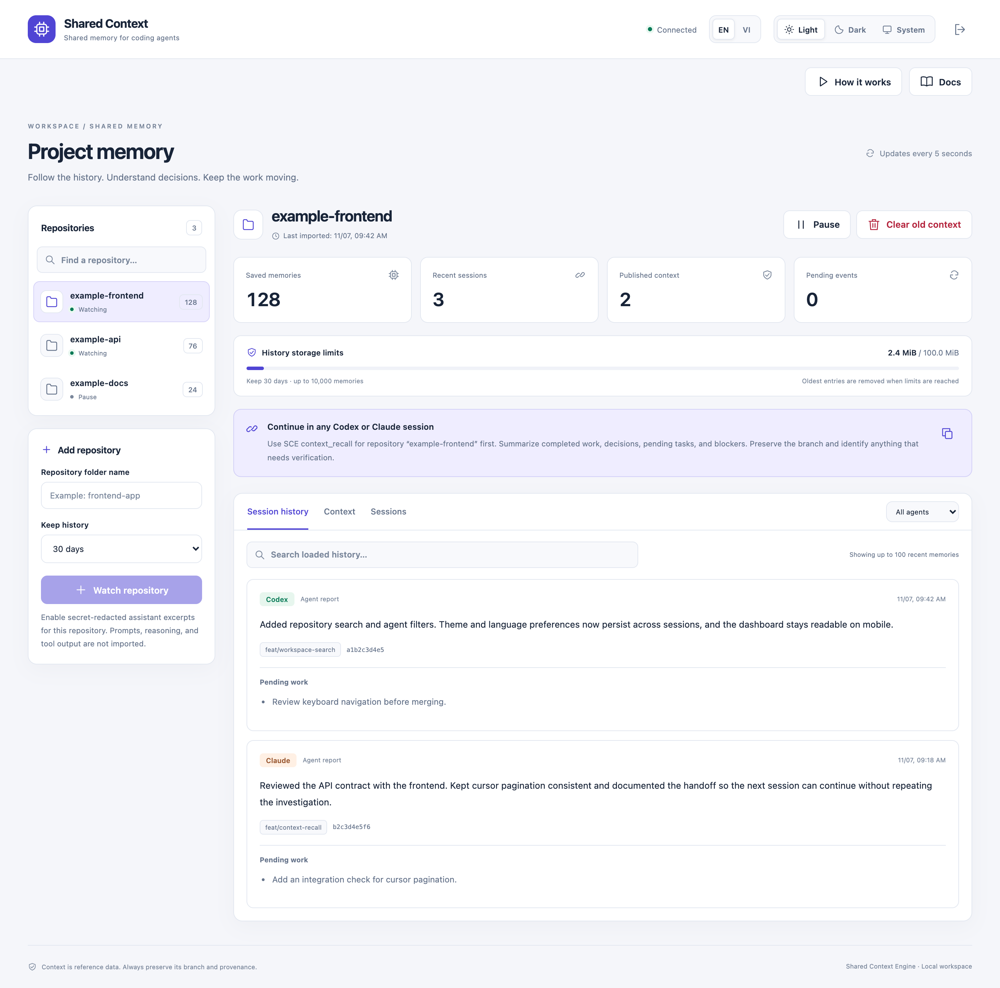
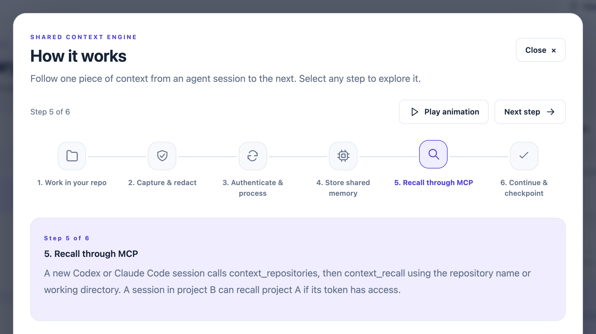
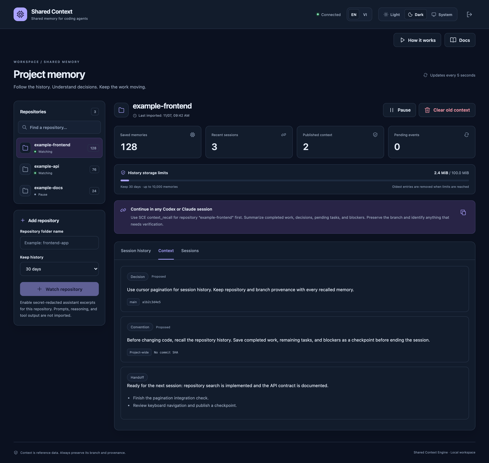

# Shared Context Engine

**Keep project context across coding sessions.**

Shared Context Engine (SCE) is a local service that gives coding agents a shared memory across sessions and repositories. Collect supported Codex and Claude Code assistant summaries, browse them in a dashboard, and recall relevant work through MCP before picking up a task.

[Quick start](#quick-start) · [Connect your agent](#connect-your-agent) · [Documentation](#documentation) · [Tiếng Việt](docs/HUONG-DAN-SU-DUNG.md)



_A shared workspace for repository history, agent sessions, and the next task. Screenshots use demo data._

## What it does

- **Session continuity.** Recall previous work, pending tasks, and handoffs when starting a new session.
- **Repository context.** Watch selected local Git repositories and retrieve context by repository name.
- **Durable memory.** Store decisions, conventions, contracts, and checkpoints alongside session history.
- **Local dashboard.** Browse history, search loaded memories, and manage retention with English/Vietnamese and light/dark themes.
- **MCP access.** Connect multiple clients to one service through a generated configuration.

## A closer look

### From a session to shared memory

Selected repository logs flow through the observer and redaction into local storage. Agents recall that context through MCP and save checkpoints for the next session.



### Decisions and handoffs, ready for the next session

Keep durable decisions, conventions, and pending work beside session history. The dashboard supports both light and dark themes.



## Quick start

Requires **Node.js 22.13+**, **npm**, and **Git**. From the project directory:

```sh
npm ci
npm run dev
```

1. Open [localhost:3000](http://localhost:3000).
2. Copy the contents of `.local/dev-token` into **Access token** and connect.
3. Enter a local Git repository's folder name, choose its history window, and select **Watch repository**.

The default workspace is the parent of the SCE installation directory. If your repositories live elsewhere, set `SCE_WORKSPACE_ROOTS` before starting the service. Use your operating system's path separator for multiple roots. See the [configuration guide](docs/CONFIGURATION.md).

Local development creates its own token and persistent PGlite database. It does not require a `.env` file, Docker, or Redis. Stop with **Ctrl+C**; restarting reuses your local data.

## Connect your agent

With the local service running, generate a configuration for your client:

```sh
# Codex: TOML
npm run mcp:config

# Claude Code: JSON
npm run mcp:config -- claude
```

Merge the generated `sce` server entry into your client's MCP configuration, then restart the client and open a new session. The command calculates paths for your installation; it does not edit client settings or print the token. Treat the generated output as local configuration.

Try this prompt, replacing `example-app` with a watched repository's name:

> Read the SCE history for repository example-app, summarize the pending work, and continue the task.

Agents can use `context_repositories` to list watched repositories, `context_recall` to retrieve history, and `context_checkpoint` to save a summary. When recalling another repository, pass its name without the current repository's `cwd`. Adding another watched repository does not require changing the MCP configuration.

## Data and privacy

Runtime data stays in `.local/` for the default local setup. The observer imports supported assistant summary excerpts for watched repositories; it does not persist whole transcripts, user prompts, reasoning, or tool payloads. Summaries may still contain private project information. Redaction handles recognized secret patterns, not every form of sensitive text.

Session history defaults to **30 days**, with limits of **10,000 memories** or **100 MiB of content per repository**. Durable context and pending events are retained separately. These limits are not a hard quota for the entire database. See [retention and cleanup](docs/RETENTION.md).

Publish this repository directly. Keep `.local/`, `.env` files, generated MCP settings, and agent logs out of Git; see [publishing on GitHub](docs/SHARING.md).

## Docker

For the PostgreSQL/Redis stack:

```sh
cp .env.example .env
# Replace every password/token placeholder and update the matching connection URLs.
docker compose up -d --build --wait
```

The dashboard and API bind to loopback by default; PostgreSQL and Redis stay on the Compose network. Containers do not observe host agent logs. Use `npm run dev` for the local repository watcher. Remote team deployments require OIDC and membership provisioning; local authentication assumes a single machine owner.

## Development

```sh
npm run check                # TypeScript build and unit/integration tests
npm run build:dashboard      # Production dashboard build
npm run format:check         # Formatting
npm run test:memory-smoke    # Isolated local stack and MCP workflow
npx playwright install chromium
npm run test:ui              # Dashboard tests with mock data
```

Smoke tests use separate databases and ports. UI tests use synthetic repository data.

| Directory   | Purpose                                                    |
| ----------- | ---------------------------------------------------------- |
| `apps/`     | API, dashboard, and background worker                      |
| `packages/` | Context engine, storage, observer, retention, and security |
| `cli/`      | Lifecycle wrapper and offline event spool                  |
| `adapters/` | Client integration examples                                |
| `docs/`     | Setup, configuration, and API reference                    |
| `tests/`    | Automated tests and synthetic fixtures                     |

## Documentation

- [Hướng dẫn sử dụng bằng tiếng Việt](docs/HUONG-DAN-SU-DUNG.md)
- [Configuration reference](docs/CONFIGURATION.md)
- [MCP tools and API contracts](docs/api/README.md)
- [Retention and cleanup](docs/RETENTION.md)
- [Dashboard help](docs/UI-HELP.md) and [language settings](docs/LANGUAGES.md)
- [Publishing on GitHub](docs/SHARING.md)

Agent history is reported context, not verified evidence of code changes. Log formats vary by client version, and logs unavailable on the host cannot be observed. Recall instructions guide clients but do not force every chat to load context automatically.

## Author

Created by [tuanngv244](https://github.com/tuanngv244).

## License

[MIT](LICENSE)
